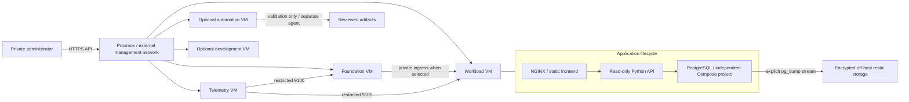

# Architecture: a fictional operated homelab

The reference preserves engineering patterns: virtualized workloads, host-level
configuration, isolated service responsibilities, separate database lifecycle,
private administration, telemetry and recovery. It deliberately does not model a
private installation's topology, machine count, hardware, policy or identities.

## Layers and ownership

1. Operator/hardware: physical Proxmox installation, bridges, VLAN transport,
   storage pools, trusted HTTPS, cloud-init template and scoped API account.
2. Terraform: guest IDs, cloning, CPU/RAM, virtual OS/data disks, NIC and cloud-init.
3. Ansible baseline: packages, guest agent and narrowly configured node exporter.
4. Ansible runtime: checksum-verified package source, exact package versions,
   dedicated storage and bounded Docker logging. No broad docker-group access.
5. Service bundles: independently selectable Compose projects with explicit image,
   bind and external secret inputs. DNS is native on the foundation VM.
6. Operations: acceptance, controlled promotion, encrypted backups and restore
   evidence. Publication of an image and deployment are different actions.

## Fictional guest catalog

The [example catalog](../../infrastructure/proxmox/examples/lab.json) is the common input
for Terraform and the offline inventory renderer. These are new teaching values,
not anonymized copies of operational guests.

| Role | Example name / ID | vCPU / RAM | OS + data GiB | Selection |
| --- | --- | --- | --- | --- |
| foundation | resolver01 / 2407 | 1 / 1 GiB | 16 + 8 | Virtualized DNS; ingress optional |
| applications | workload01 / 2423 | 2 / 3 GiB | 24 + 32 | Web/API and separately managed database |
| telemetry | metrics01 / 2441 | 2 / 3 GiB | 24 + 32 | Metrics and dashboards |
| automation | builder01 / 2467 | 2 / 3 GiB | 24 + 24 | Optional controller; agent capacity separate |
| sandbox | sandbox01 / 2489 | 2 / 2 GiB | 24 + 16 | Optional private development |

The three-role example allocates 7 GiB of guest RAM and 136 GiB of virtual disk;
reserve additional capacity for Proxmox, template, backups and growth. All five
allocate 12 GiB and 224 GiB; these are budgets, not measured recommendations or
requirements. Start with the workload guest and add roles incrementally.

Each data disk starts as an unformatted virtual disk. The operator prepares
`/srv/lab` and records its UUID separately. No code automatically selects,
partitions, formats or migrates a disk. Application volumes live under the
reviewed Docker storage root on that filesystem. Hypervisor snapshots are not
an independent backup.

## Relationships and security boundaries

Authoritative DNS serves the fictional zone to explicit clients; it cannot
resolve arbitrary Internet names. Use an independent resolver/conditional
forwarder designed outside this repository. Private ingress can proxy to selected
backend IPs, but all published service defaults remain loopback-only. A backend
must be deliberately bound to its private address and isolated before cross-VM
access. No router, host firewall or NAT policy is installed by this project.

Monitoring scrapes configured guests over private network paths. Prometheus
rules detect unavailable targets locally; no delivery to email/chat is included.
Grafana uses a file-delivered private password. Jenkins retains its setup wizard,
has zero controller executors and requires a separately provisioned validation
agent. No CI job is authorized to promote images to a real environment.

TLS issuance/renewal and VPN remain design/template responsibilities, not accepted
operational components. The [network guide](../network/design.md) explains
where those controls must exist before exposing any service.
