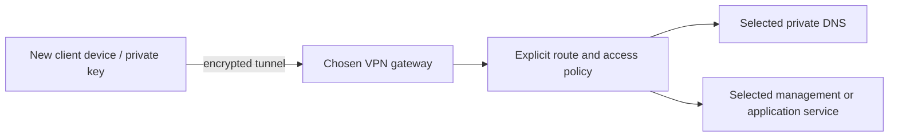

# WireGuard: understand the private-access path

Read [the decision](../decisions/0003-wireguard-private-access.md) before adapting
[the fictional template](../../operations/network/wireguard/wg0.conf.example).
This is an explanation and adaptation checklist, not a working peer inventory.

## What each piece does

- A private key stays on its device; a public key identifies that peer to others.
- An endpoint tells a peer where another peer can be reached. Reachability through
  NAT/provider policy is a separate prerequisite; this repo supplies no endpoint.
- Tunnel addresses belong to the new private network you design. They are not
  automatically the same as LAN/server addresses.
- AllowedIPs associates a peer with permitted source addresses on receipt and
  selects a peer for outgoing destinations. Helper tools can also install routes.
  This does not replace forwarding policy or application authorization.

These distinctions follow [WireGuard's routing model](https://www.wireguard.com/#cryptokey-routing).
The [official quick start](https://www.wireguard.com/quickstart/) explains key and
interface setup. It is an upstream reference, not permission to execute commands.

## Design before configuring

Decide client groups and the exact services each needs. Then choose gateway,
endpoint reachability, tunnel subnet, per-device identity, destination routes,
DNS behavior, forwarding and return path. Evaluate IPv6 and overlapping client
networks. Avoid broad routes or NAT added merely to hide a missing design.
A DNS setting in a client/helper configuration is not DNS service delivered by
the WireGuard protocol; verify what the selected client actually configures.

The authoritative BIND9 example only answers for its private zone. It must not
be advertised as a general recursive resolver. Decide conditional forwarding or
a separate recursive resolver before directing ordinary client DNS to it.

## Trial and acceptance order

1. Generate fresh keys privately; do not paste private keys into chat or logs.
2. In an approved disposable environment, verify the intended peer connection.
3. Verify a permitted destination and its return path, then a destination that
   must be denied. A successful handshake alone is not network acceptance.
4. Check private name resolution, unrelated DNS behavior and IPv6 boundaries.
5. Reconnect/reboot only when separately authorized and verify persistence.
6. Rehearse removing a lost device and recovery without the usual tunnel.

Record dated outcomes privately. No real peer configuration, route, DNS setting,
router export or key metadata belongs in this public tree. This reference has
not deployed or accepted a VPN.
