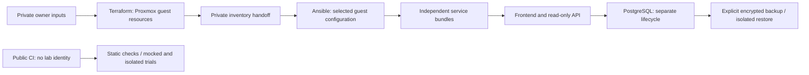

# Engineering case study: an operated-lab reference without private inventory

## Problem

A homelab is useful as an engineering example only when a reader can understand
its decisions, adapt its inputs, validate changes and recover its data. An actual
installation also contains identities, topology, operational policies and evidence
that should not become someone else's public template.

This project preserves the responsibilities and professional process while using
independently authored code and fictional inputs. It targets both a technical
portfolio reader and a new owner working with an AI coding assistant.

## Architecture and engineering decisions

| Decision | Engineering purpose | Trade-off |
| --- | --- | --- |
| Five responsibility categories | Keep explanation, resources, operation, custody and services discoverable | Requires maintaining indexes with code changes |
| Terraform/Ansible/Compose ownership | Avoid two tools managing the same resource | Cross-layer handoffs need explicit inputs and evidence |
| Separate app/database projects | A web update cannot implicitly run SQL or restore data | Compatibility and recovery become explicit operations |
| Explicit static-file delivery manifest | Prevent generated config churn and avoid shipping local env/private files | New files must be deliberately declared |
| Single package-version transaction plus observed checks | Resolve one reviewed runtime selection together and stop on mismatch | Repository availability and real convergence still need a guest trial |
| Digest-based public image baseline | Keep example image identity stable between readers/runs | Pinning does not establish vulnerability or runtime safety |
| VPN/identity policy separate from template | Explain private access without publishing actual peers or routes | Each owner must design and verify their own network boundaries |

[The ADRs](../decisions/README.md) explain why these choices fit this reference and
where another choice may be simpler. [WireGuard](../decisions/0003-wireguard-private-access.md)
and [secret custody](../decisions/0005-secrets-and-custody.md) are design/template
examples, not accepted deployments.

## Concrete quality work

The initial staging flow copied a sample Prometheus config over the generated
file on each delivery. Regression tests now run the real staging tasks locally
and establish that a second pass and README-only changes produce zero changes,
while inventory/static config changes are actually delivered. Only temporary
paths/ownership are substituted; no VM or container engine is used by those tests.

The runtime installer now requests the complete package/version set in one apt
operation and verifies installed versions before startup. Regression tests cover
the complete request and mismatch rejection; no real apt transaction is claimed.

An isolated integration harness derives its stack from the canonical Compose
files, removes published ports, uses new synthetic identities/data and a separate
restore destination, and cleans up only its own test resources. It defaults to a
plan; execution is restricted to a fresh GitHub-hosted runner with the local
Docker socket. Its CI job and sanitized result artifact are implemented but have
now passed in the [first hosted run](../evidence/2026-11-22-publication.md).

## Evidence and limits

[Local evidence](../evidence/2026-11-22-reproducibility.md) records actual checks.
[Release readiness](../release-readiness.md) owns the publication gates. Runtime
Proxmox provisioning, guest convergence, package installation, network isolation
and a complete infrastructure recovery remain unverified. The Docker application
trial cannot prove these properties even when it passes.

The hosted synthetic application/restore milestone has passed. The next milestone
is a separately approved disposable VM trial with a second convergence pass.
A completed implementation or static/mock test is not substituted for that
acceptance. No private original infrastructure or deployment evidence is needed
to demonstrate these engineering practices publicly.
